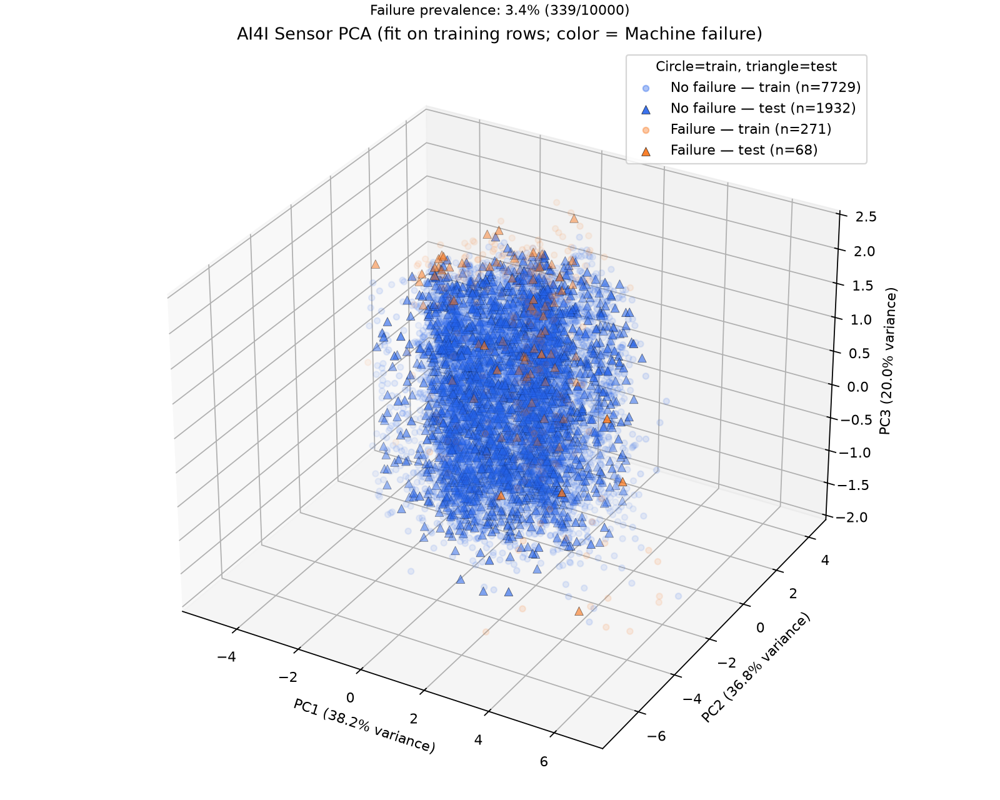
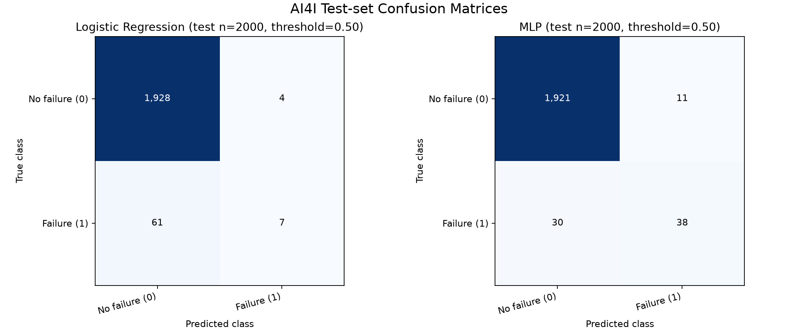
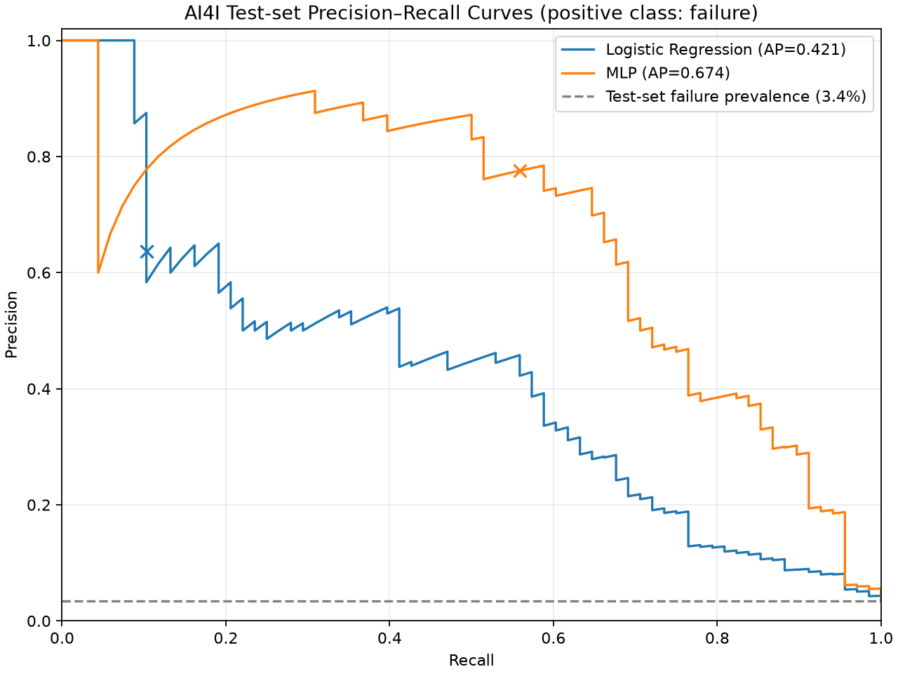
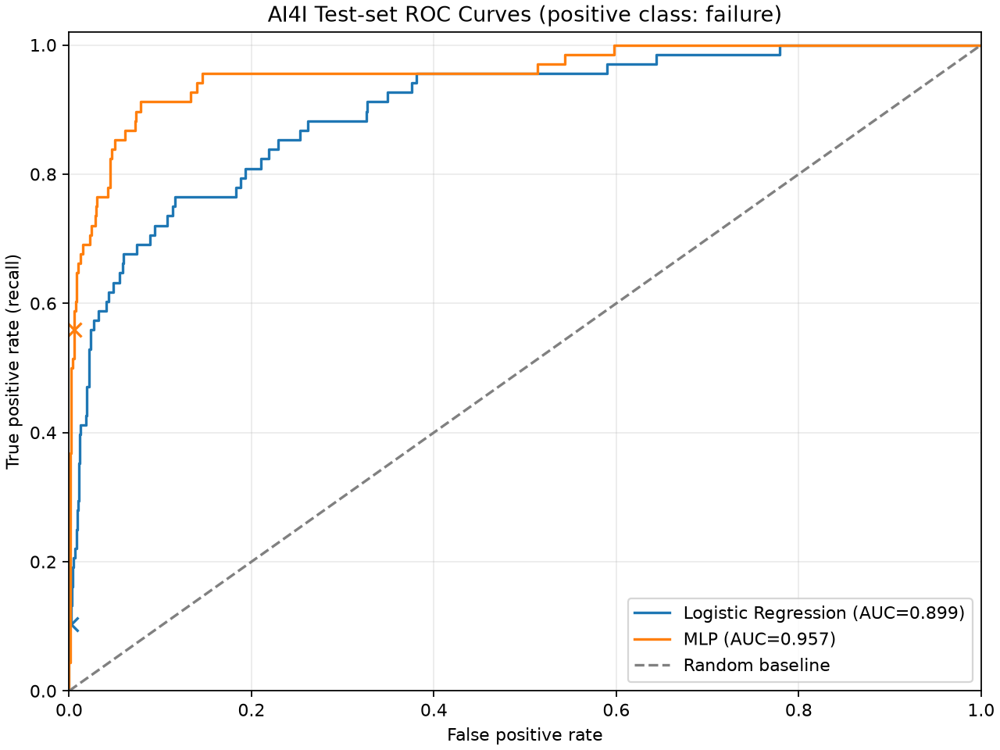
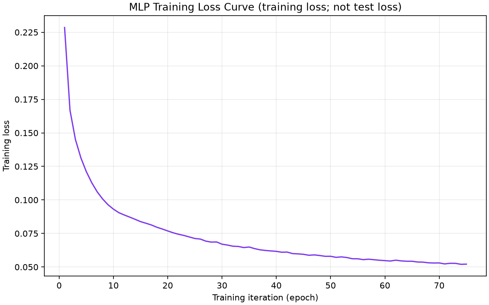
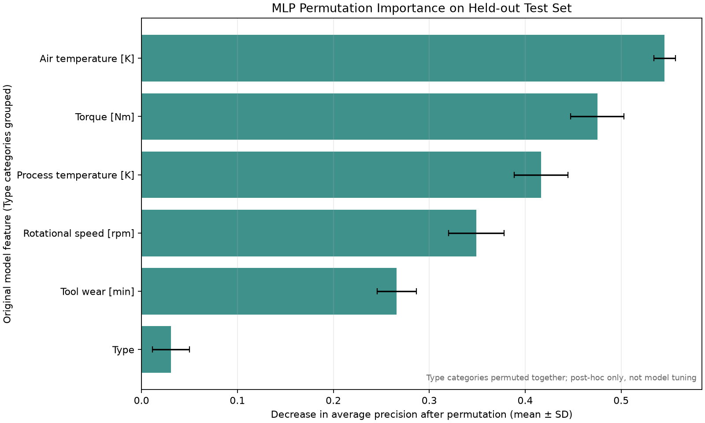

# AI4I 2020 預測性維護分類實驗：資料探索與神經網路模型比較

> 本文由 `ai4i_report.py` 根據已保存的 EDA 摘要與模型比較 JSON 產生。主要數值直接取自實驗產物；圖表以相對連結指向 `outputs/ai4i/`。

## 摘要

本研究使用 UCI Machine Learning Repository 的 AI4I 2020 Predictive Maintenance Dataset，探討產品類型與感測器量測能否辨識 `Machine failure`。資料包含 10,000 筆、14 個欄位，故障樣本 339 筆（3.39%），類別明顯不平衡。以同一個 80%/20% 分層訓練／測試切分，比較 Logistic Regression 與多層感知器（MLP），正類為故障、判定閾值為 0.50。測試集上 MLP 的 Recall 為 55.88%、ROC-AUC 為 0.957、Average Precision（本專案報告欄位稱 PR-AUC）為 0.674；Logistic Regression 對應為 10.29%、0.899、0.421。MLP 表現較佳，但仍有漏判；由於資料是合成資料且僅使用一次隨機切分，本結果不代表真實產線設備的預測能力。

**關鍵詞：** 預測性維護、AI4I 2020、類別不平衡、MLP、故障分類

## 1. 研究背景

預測性維護希望利用設備狀態資訊，在故障發生前辨識風險。本研究以二元分類作為可重現的基準實驗：輸入同一筆觀測中的產品類型與五項感測器特徵，預測該筆觀測是否標記為整體機器故障。由於資料沒有時間戳記或預測提前量，本研究分類的是同筆觀測的故障標籤，**不等於故障發生前的提前預警**。研究問題為：在不使用識別碼或故障模式標籤的條件下，MLP 相較於 Logistic Regression 是否能在固定測試切分上提高故障辨識能力？本實驗比較模型的測試集指標，不建立可直接部署的維修決策系統。

## 2. 資料集與資料探索

資料來自 [UCI AI4I 2020 資料集頁面](https://archive.ics.uci.edu/dataset/601/ai4i+2020+predictive+maintenance+dataset)。UCI 說明此資料為反映產業情境的**合成資料（synthetic data）**，並以 CC BY 4.0 授權發布 [1]。專案保存的 CSV 共 10,000 筆、14 欄；檢查得到缺漏值 0 個、重複列 0 筆。分析中的整體標籤 `Machine failure` 有 9,661 筆非故障與 339 筆故障，故障率 3.39%，非故障與故障約為 28.5:1。

| 欄位 | 說明 | 本研究角色 |
|---|---|---|
| `UDI` | 唯一資料列識別碼 | 排除 |
| `Product ID` | 產品識別碼，含產品類型與序號 | 排除 |
| `Type` | 產品品質類型（L、M、H） | 模型特徵 |
| `Air temperature [K]` | 空氣溫度（K） | 模型特徵 |
| `Process temperature [K]` | 製程溫度（K） | 模型特徵 |
| `Rotational speed [rpm]` | 旋轉速度（rpm） | 模型特徵 |
| `Torque [Nm]` | 扭力（Nm） | 模型特徵 |
| `Tool wear [min]` | 刀具磨耗時間（min） | 模型特徵 |
| `Machine failure` | 整體機器故障標籤（0/1） | 分類目標 |
| `TWF` | 刀具磨耗故障標籤 | 排除：避免標籤洩漏 |
| `HDF` | 散熱故障標籤 | 排除：避免標籤洩漏 |
| `PWF` | 功率故障標籤 | 排除：避免標籤洩漏 |
| `OSF` | 過度應力故障標籤 | 排除：避免標籤洩漏 |
| `RNF` | 隨機故障標籤 | 排除：避免標籤洩漏 |

`TWF`、`HDF`、`PWF`、`OSF`、`RNF` 分別代表刀具磨耗、散熱、功率、過度應力及隨機故障模式；本次資料中正標籤筆數為 TWF=46、HDF=115、PWF=95、OSF=98、RNF=19。故障模式可同列重疊，這些筆數不可相加當作整體故障筆數。整體分類僅使用 `Machine failure` 作目標，不把模式欄位當輸入。

探索性分析亦顯示，空氣溫度與製程溫度相關係數為 0.876，轉速與扭力為 -0.875。相關性描述此資料內的共同變動，不代表因果關係。

## 3. 研究方法

### 3.1 特徵處理與資料切分

模型輸入為同筆觀測的 `Type` 與五項感測器量測，預測該筆資料的 `Machine failure` 標籤；本研究未定義往前預測的時間窗。排除 `UDI`、`Product ID` 以及五個故障模式標籤，以避免識別資訊與目標相關標籤洩漏。使用固定亂數種子 42 進行 80%/20% 分層切分：訓練集 8,000 筆（非故障 7729、故障 271），測試集 2,000 筆（非故障 1932、故障 68）。`Type` 以 one-hot 編碼，數值特徵以標準化處理，兩者皆只在訓練資料擬合，再轉換測試資料。

### 3.2 分類器與評估

比較 l2 正則化 Logistic Regression（最多 2000 次迭代）與 scikit-learn `MLPClassifier`。MLP 使用隱藏層（32, 16 個節點）、relu、adam、初始學習率 0.001、`alpha=0.0001`、最多 500 次迭代及 early stopping（啟用；內部分割比例 0.1）。兩模型使用相同資料切分，固定機率閾值 0.50，不重採樣，也不以測試集搜尋超參數或閾值。MLP 本次訓練 75 次迭代；收斂警告：無。

報告 accuracy、precision、recall、F1、ROC-AUC 與 PR-AUC。此專案 JSON 中的 PR-AUC 指標以 **Average Precision** 計算，PR 曲線以同一測試集預測分數繪製；這裡不將其解讀為梯形積分近似值。混淆矩陣固定以真實類別為列、預測類別為欄，類別順序皆為 `[0, 1]`。

### 3.3 PCA 與模型解釋圖

PCA 使用五項數值感測器特徵；標準化與 PCA 僅以訓練列擬合，故障標籤只用於圖中著色。PCA 是低維投影，不是分類器的預測結果。Permutation importance 以保留測試集的 Average Precision 下降量作 MLP 事後解釋，`Type` 的 one-hot 欄位一起置換；它不代表因果效果，也不參與模型調整。

## 4. 實驗結果

### 4.1 測試集分類指標

| 模型 | Accuracy | Precision | Recall | F1 | ROC-AUC | Average Precision（PR-AUC） |
|---|---:|---:|---:|---:|---:|---:|
| Logistic Regression | 96.75% | 63.64% | 10.29% | 17.72% | 0.899 | 0.421 |
| MLP | 97.95% | 77.55% | 55.88% | 64.96% | 0.957 | 0.674 |

| 模型 | TN | FP | FN | TP |
|---|---:|---:|---:|---:|
| Logistic Regression | 1928 | 4 | 61 | 7 |
| MLP | 1921 | 11 | 30 | 38 |

測試集只要一律預測非故障，Accuracy 即為 96.60%；因此高 Accuracy 單獨不足以支持故障辨識能力。固定閾值下，Logistic Regression 找出 7 筆故障、漏掉 61 筆；MLP 找出 38 筆、漏掉 30 筆，並分別產生 4 與 11 筆非故障誤報。

### 4.2 PCA 感測器分布



### 4.3 測試集分類曲線與混淆矩陣







### 4.4 MLP 訓練與特徵 permutation importance

Loss 圖呈現訓練損失，不是測試損失。



| 原始特徵 | Average Precision 平均下降量（10 次置換，平均 ± 標準差） |
|---|---:|
| `Air temperature [K]` | 0.5452 ± 0.0113 |
| `Torque [Nm]` | 0.4753 ± 0.0278 |
| `Process temperature [K]` | 0.4165 ± 0.0280 |
| `Rotational speed [rpm]` | 0.3489 ± 0.0289 |
| `Tool wear [min]` | 0.2661 ± 0.0205 |
| `Type` | 0.0307 ± 0.0192 |



## 5. 討論

在此固定切分與設定下，MLP 的 Recall、F1、ROC-AUC 與 Average Precision 均高於 Logistic Regression，顯示它在本次測試資料上辨識出較多故障樣本。另一方面，MLP 仍漏掉 30 / 68 筆故障，並有 11 筆誤報；是否合適需依漏報與誤報成本及操作閾值評估，不能只據此宣稱已可部署。測試集故障率約 3.40%，PR 曲線的基準線因此遠低於高 Accuracy 所暗示的直覺。

本次 MLP permutation importance 中，平均精確率下降量較高的原始特徵為 `Air temperature [K]`。這只表示在此模型、資料切分與評分方式下置換特徵會造成較大分數變化；溫度、轉速、扭力等特徵間的相關性也可能影響重要度排序。PCA 圖則用來檢視感測器資料的低維投影，不足以單獨證明類別在真實製程中可分。

## 6. 研究限制

1. **合成資料限制：** UCI 明確標示資料為合成資料，不能代替真實工廠設備、不同機台或不同故障分布的外部驗證，因此不將本結果外推為產線效能；本分類任務也不是預先設定提前量的故障預警。
2. **單次隨機切分：** 結果來自一個固定種子的分層 holdout，沒有交叉驗證、信賴區間或跨機台測試，對抽樣變化的穩健性尚未量化。
3. **時間泛化未驗證：** 專案 CSV 沒有明確時間戳記，本研究使用隨機列切分；這不能回答依時間先後部署時的預測能力。
4. **閾值與訓練設定固定：** 閾值 0.50 及模型參數未經操作成本導向調整。實務上應在獨立驗證資料上選擇閾值並做成本分析。
5. **標籤與解釋限制：** 故障模式標籤可能重疊；Permutation importance 是測試集上的事後模型解釋，不是因果分析。單次 loss curve 只呈現訓練最佳化過程。

## 7. 結論

本研究完成 AI4I 2020 資料檢查、探索、PCA 視覺化，以及 Logistic Regression 與 MLP 的可重現分類比較。在固定測試切分中，MLP 的故障 Recall 為 55.88%，高於 Logistic Regression 的 10.29%，但仍漏掉部分故障。由於樣本為合成資料、故障比例低且僅有一次隨機 holdout，結果適合作為分析流程示範與後續驗證起點，不足以證明模型可直接用於實際設備。

## 8. 重現方式與環境

在專案根目錄使用 Python 3.10 以上版本。若 `py` 啟動器不可用，可改用 `python -m venv .venv`，或指定已安裝的 Python 3.10 以上執行檔建立環境。建立虛擬環境並安裝 `requirements.txt` 後，依序取得／驗證資料、重做 EDA、訓練模型、產生圖表，再生成本報告：

```powershell
py -m venv .venv
.venv\Scripts\python.exe -m pip install -r requirements.txt
.venv\Scripts\python.exe ai4i_data.py --download
.venv\Scripts\python.exe ai4i_eda.py
.venv\Scripts\python.exe ai4i_modeling.py --test-size 0.2 --random-state 42
.venv\Scripts\python.exe ai4i_visualization.py
.venv\Scripts\python.exe ai4i_report.py
.venv\Scripts\python.exe -m unittest discover -s tests -v
```

若已保存 `data/ai4i2020.csv`，可略過下載並執行 `.venv\Scripts\python.exe ai4i_data.py` 驗證本機資料。報告引用 [EDA 摘要](ai4i_eda/summary.json) 與[模型比較 JSON](ai4i_modeling/model_comparison.json)，並核對兩份報告的資料指紋（SHA-256：`1dcd9c32543beb77921a24c18d79525e698c8b055e85b3320486b427e79f5b1f`）；圖表位於 `ai4i/`。本次實驗記錄的環境為 python 3.12.14, numpy 2.5.4, pandas 3.1.0, scikit_learn 1.9.1（Python 3.12.14）。固定亂數種子可重現資料切分；若套件版本或平台不同，模型數值可能有細微差異，實際版本請以模型 JSON 的環境欄位為準。

## 參考資料

[1] UCI Machine Learning Repository. (2020). *AI4I 2020 Predictive Maintenance Dataset* [資料集]. DOI: [10.24432/C5HS5C](https://doi.org/10.24432/C5HS5C). CC BY 4.0. [資料集與變數說明](https://archive.ics.uci.edu/dataset/601/ai4i+2020+predictive+maintenance+dataset)。
