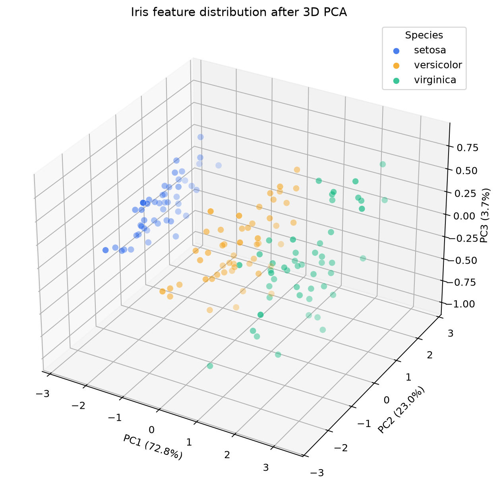
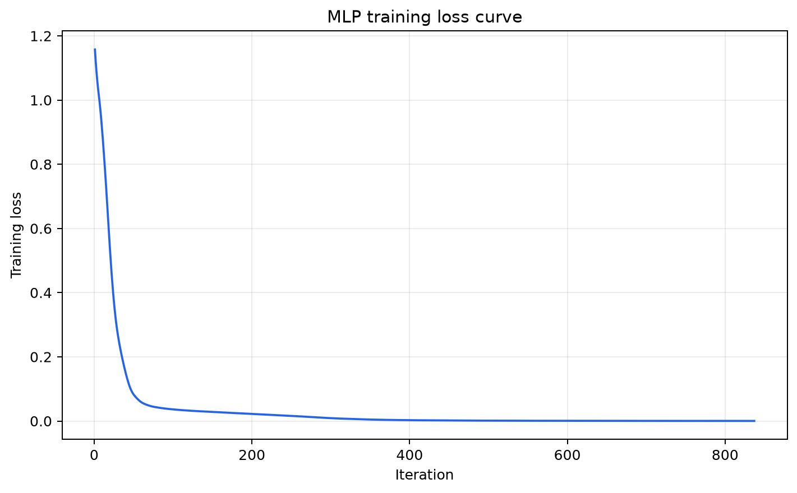
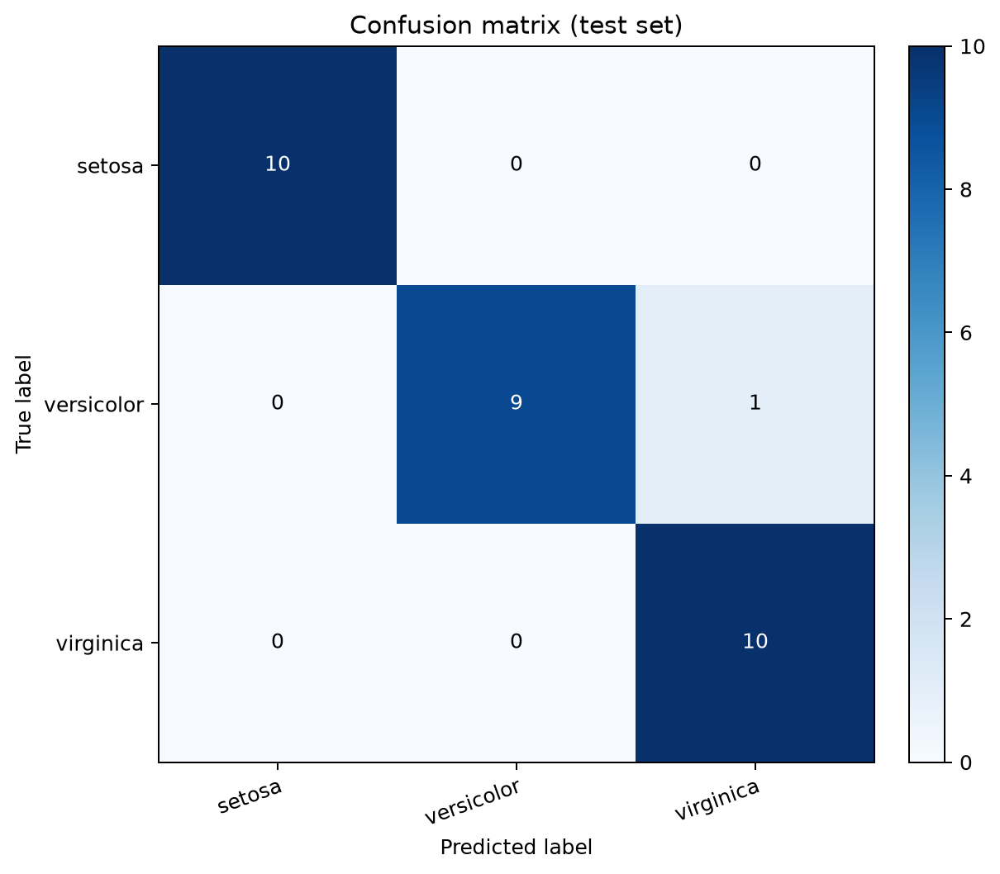
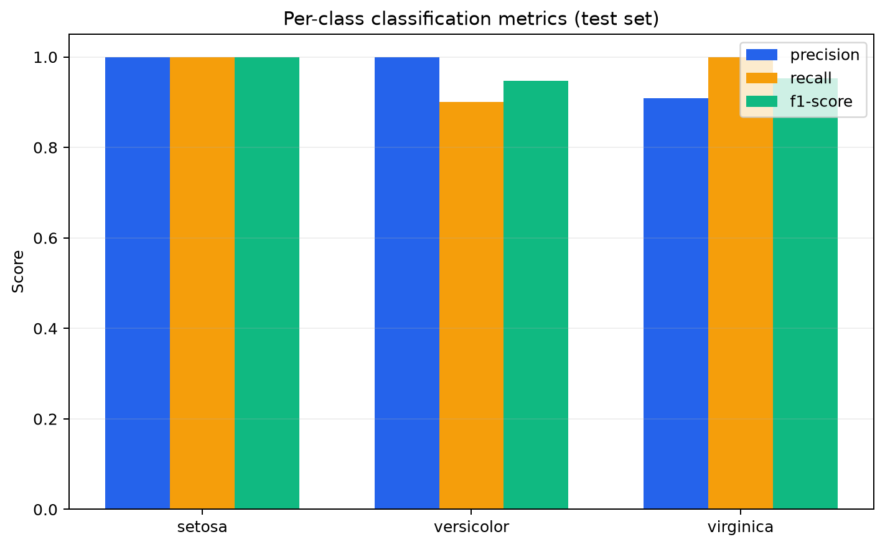

# Iris 資料探索與神經網路分類：一項可重現的基準實驗

## 摘要

本研究以 UCI Machine Learning Repository 的 Iris 資料集探索四項花朵測量特徵，使用主成分分析（PCA）呈現三維特徵分布，並以標準化與多層感知器（MLP）建立三分類模型。資料共 150 筆，分屬三個平衡類別；資料品質檢查發現 0 個缺失值與 3 筆重複列。以固定亂數種子進行分層 80/20 切分後，測試集準確率為 **0.967**（30 筆）。本結果顯示此小型資料集適合示範探索式視覺化與監督式分類流程，但單次切分的分數不應視為普遍效能保證。

**關鍵詞：** Iris、PCA、多層感知器、分類、模型評估

## 一、研究目的

鳶尾花資料集常用於示範分類方法。本實驗依序檢查資料欄位與品質、觀察不同類別在三個主成分上的分布，並評估類神經網路能否由萼片和花瓣的量測值辨識物種。

## 二、資料與方法

### 2.1 資料集

資料取自 UCI Machine Learning Repository 的 Iris 資料集（Fisher, 1936；CC BY 4.0）。原始檔 `data/iris.data` 為無標題列的 CSV。資料含 150 筆、四個連續數值特徵及一個類別目標；每個類別各有 50 筆。

| 欄位 | 說明 | 全體平均（公分） | 最小–最大（公分） |
|---|---|---:|---:|
| `sepal_length_cm` | 萼片長度（sepal length） | 5.84 | 4.3–7.9 |
| `sepal_width_cm` | 萼片寬度（sepal width） | 3.05 | 2.0–4.4 |
| `petal_length_cm` | 花瓣長度（petal length） | 3.76 | 1.0–6.9 |
| `petal_width_cm` | 花瓣寬度（petal width） | 1.20 | 0.1–2.5 |

目標欄位為 `species`，類別分布如下：

| 分類標籤 | 筆數 |
|---|---:|
| Iris-setosa | 50 |
| Iris-versicolor | 50 |
| Iris-virginica | 50 |

資料完整性檢查確認特徵和目標欄位共 5 欄，缺失值 0 個、完全重複列 3 筆。欄位型態為：`sepal_length_cm: float64, sepal_width_cm: float64, petal_length_cm: float64, petal_width_cm: float64, species: string`。

### 2.2 三維 PCA 視覺化

先將四個特徵以標準分數轉換，再以 PCA 投影到前三個主成分。前三個主成分依序解釋 **72.77%**、**23.03%**、**3.68%** 的變異，累積解釋變異為 **99.48%**。圖中以顏色表示物種；此圖用於探索結構，不作為模型測試資料的評估。

### 2.3 分類器與評估方式

以固定亂數種子 42 執行分層抽樣，保留 80%（120 筆）作為訓練集、20%（30 筆）作為測試集。分類流程先使用 `StandardScaler`，再訓練含 16 與 8 個神經元兩個隱藏層的 MLP，採 ReLU、Adam、初始學習率 0.01。標準化器只在訓練資料上擬合，避免測試資料資訊洩漏。以準確率、各類別 precision/recall/F1 和混淆矩陣評估模型。

## 三、實驗結果

模型在 837 次迭代後停止，最後訓練損失為 0.00030。測試集準確率為 **0.967**，macro-average precision、recall、F1 分數分別為 **0.970**、**0.967**、**0.967**；weighted-average F1 為 **0.967**。

| 真實分類 \ 預測分類 | setosa | versicolor | virginica |
|---|---:|---:|---:|
| setosa | 10 | 0 | 0 |
| versicolor | 0 | 9 | 1 |
| virginica | 0 | 0 | 10 |

## 四、討論

類別平衡且沒有缺失值，讓本資料集適合直接進行基準分類。PCA 將四維特徵濃縮為三維，同時保留 99.48% 的標準化特徵變異，可用來觀察類別群聚與重疊。混淆矩陣及各類別指標應搭配閱讀：若錯誤集中在特定兩類，代表其測量特徵在本次切分中較難區分。MLP 的結果受切分、初始化和超參數影響；本研究使用單一固定切分且未進行系統化調參，因此不能據此比較所有模型或推論部署效能。

## 五、結論

本實驗完成資料探索、三維 PCA、神經網路訓練與測試集評估，並產生訓練歷程、混淆矩陣及分類指標圖。固定種子的結果可由專案程式重現；後續可用分層交叉驗證與不同基準模型，檢查分數對資料切分的敏感度。

## 參考資料

Fisher, R. A. (1936). *Iris* [Dataset]. UCI Machine Learning Repository. https://doi.org/10.24432/C56C76. 資料集說明與欄位資訊：https://archive.ics.uci.edu/dataset/53/iris。License: CC BY 4.0.

Pedregosa, F., et al. (2011). Scikit-learn: Machine Learning in Python. *Journal of Machine Learning Research, 12*, 2825–2830. https://jmlr.org/papers/v12/pedregosa11a.html.
